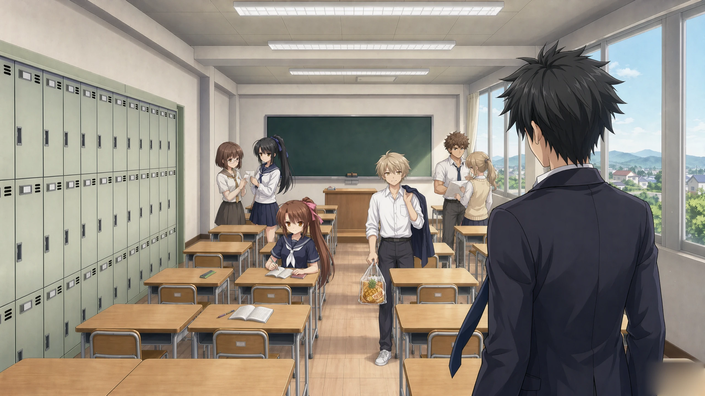

<div align="center">

# 笑樱 · Xiaoying

**不会笑的少女 × 被孤立的不良少年 —— 围绕一张旧长椅展开的「笑」与「陪伴」**

自制视觉小说引擎 · 单线长篇 Galgame · 8 章 / 59 场 / 约 6,900 行台本



</div>

---

## 关于

《笑樱》是一部**第一人称、单线（篠宫樱）、无分支**的视觉小说。玩家就是主角**芥川龙司** —— 一个习惯了独处、把「坐在旧长椅上发呆」当作全部社交需求的人。某天，那张长椅被一个**不会笑的少女**占了。

本作不做「靠付出换好感」的廉价恋爱，也不写无所不能的主角：两个人都有自己的柔弱之处，恋情的关键在于**看清双方真实的所在**。

| 项 | 内容 |
|---|---|
| 体裁 | Visual Novel（视觉小说），无分支路线 |
| 线路 | 篠宫樱 单线，其余角色为配角／外部压力 |
| 视角 | 第一人称（玩家 = 芥川龙司） |
| 篇幅 | 8 章 / 59 场 / 6,821 行台本，拆屏后约 1,880 条台词，朗读约 100 分钟 |
| 语音 | 全篇日配（AI 语音合成，樱 + 阳太 两条音轨） |
| 音频 | BGM 12 首（无缝循环）+ 音效 29 首 + 语音 832 条 |
| 美术 | 背景 29 键（已出图 10）· 事件 CG 46 键（已出图 47）· 全 WebP，2560×1440 母版 |
| 分辨率 | 设计基准 1920×1080，UI 按舞台高度自适应缩放到手机竖屏 |
| 当前状态 | **测试版 v0.2.0** —— 主线可从头玩到第 8 章；存档持久化、回想（Backlog）仍在完善 |

<details>
<summary><b>章节目录</b>（点开有剧透）</summary>

1. 长椅被霸占了
2. 长椅是两个人的了
3. 一颗糖的重量
4. 传闻的重量
5. 樱的归来
6. 同场
7. 周四
8. 那件想问你的事

</details>

---

## 技术栈

**全部代码（引擎 + 编译器 + 打包脚本）为本项目自行实现，未使用现成 Galgame 引擎（不用 Ren'Py / Kirikiri / NScripter）。**

### 运行时

| 层 | 选型 | 说明 |
|---|---|---|
| 语言 | **TypeScript 5.5**（`strict` + `noUnusedLocals`） | 全量类型约束 |
| UI 框架 | **React 18.3** | 只负责 UI 层（对话框、菜单、存读档、设置） |
| 构建 | **Vite 5.4** | 开发热更新 + 生产打包 |
| 画面渲染 | **PixiJS 8**（WebGL2） | 舞台、图层、粒子、转场、时间/天气滤镜全在 GPU |
| 补间动画 | **GSAP 3** | 演出时间轴 |
| 运行时校验 | **zod 3** | 校验编译产物 `script.json` 的结构完整性 |
| 音频 | **HTMLAudioElement 三分轨**（BGM / SE / 语音） | 手写 400 ms 交叉淡入淡出、语音单声道独占、无素材静默降级 |
| 状态管理 | 自研轻量 store（`GameState` + 订阅） | 未引入 Redux／Zustand，避免为单线叙事过度抽象 |
| 存档 | `localStorage`（经 `StorageAdapter` 抽象） | 便于后续切换 Tauri 文件系统落盘 |
| 样式 | 原生 CSS + CSS 变量 | 无 CSS-in-JS，UI 缩放靠变量与 `transform` |
| 测试 | **Vitest 2** | 引擎单测 + 验收用例 |

### 宿主与打包

| 目标 | 方案 |
|---|---|
| 桌面（Windows） | **Tauri 2**（Rust 宿主 + 系统 WebView2），产出单文件 exe |
| 移动（Android） | **Tauri 2 + Gradle** → APK（同一套前端，移动端另有全屏/安全区适配） |

### 工具链

| 工具 | 用途 |
|---|---|
| **Node 22** + `--experimental-strip-types` | 编译器等工具脚本直接用 TS 运行，零构建步骤 |
| 自研编译管线（`tools/compiler/`） | 台本 Markdown → `script.json` / `assets.manifest.json` / 节奏报告 |
| **Python 3** | 素材后处理（图像批处理、音频后期） |
| **ffmpeg** | 音频转码（Ogg Vorbis 44.1 kHz mono）、响度归一、裁剪 |
| **AI 生成** | 背景 / CG（文生图 + 图生图）、语音（IndexTTS-2.5 zero-shot，832 条） |
| **音效** | 程序化合成自制（七种原语：bursts / scatter / resonator / thump / voice_blip / whoosh / footstep） |

### 资源格式

- 图像：**WebP**（背景与 CG，2560×1440 → 应用内 1920×1080 舞台）
- 音频：**Ogg Vorbis**，语音 44.1 kHz 单声道 / BGM 立体声（全篇约 830 条语音，浏览器原生解码）

---

## 引擎设计要点

### 台本是唯一作者源

`.md` 台本内嵌演出记号（`■ SCENE` / `BG` / `BGM` / `SE` / `CG` / `※` 镜头 / `◆ 选项` / `〔W-xx〕` 变体窗口），编译成 `script.json` 后由引擎的 `ScriptVM` 逐条执行。

> **项目铁律：台本上写不出来的效果，程序里就不许有。** 任何「按关键词自动触发」的行为都要删掉，或变成台本里能一眼看见的一条指令。

### 选项 ≠ 分支

`◆ 选项` 只在**局部反应差分窗口**内生效（TTL 按台词条数计），收敛后回到主线 —— 全篇无分支剧情，但玩家的选择会改变**对方当场怎么回应**。

### 资源编号「钉死制」

BG / CG / SE 的编号全部钉在 `src/generated` 的 manifest 生成逻辑里，空号显式登记为保留号。台本增删行时不会让后面的资源整体前移 —— 这类错位**引擎不会报错**，只会静默画错图。

### UI 缩放

```
--ui-zoom = clamp(舞台高 / 720, 0.6, 1) × 用户倍率
```

先按 `舞台尺寸 / zoom` 布局，再统一 `transform: scale(zoom)`。桌面恰为 1.0（零变化），手机竖屏自动收缩到 0.6 下限。

---

## 目录结构

```
├─ src/                    引擎与 UI
│  ├─ engine/              脚本 VM、指令集、状态、设置
│  ├─ render/              PixiJS 舞台、图层、粒子、时段滤镜
│  ├─ audio/AudioEngine.ts 三分轨音频
│  ├─ ui/                  对话框、菜单、存读档、设置
│  └─ generated/           编译产物（⛔ 不要手改）
├─ tools/
│  ├─ compiler/            台本编译器（parser / manifest / rhythm / play）
│  ├─ build-exe.mjs        桌面打包
│  └─ build-apk.py         Android 打包（ASCII 路径中转 + gradle）
├─ public/assets/          运行时资源（bg / cg / audio）
├─ src-tauri/              Tauri 2 宿主
└─ tests/                  引擎单测
```

> 剧本源文件与开发文档**不随仓库分发**；`src/generated/script.json` 是已编译的剧本产物，引擎直接消费它。

---

## 本地运行

前置：**Node.js ≥ 22**

```bash
npm install
npm run dev          # Vite 开发服务器（默认 5173）
```

直接打开 `index.html` 是跑不起来的（需要 Vite 处理 TS 与资源路径）。

### 常用脚本

```bash
npm run typecheck    # tsc --noEmit
npm test             # Vitest 引擎单测
npm run compile      # 台本 → script.json（改了台本必须跑）
npm run manifest     # 重新生成资源清单（改了 BG/BGM/SE/CG 行后跑）
npm run play         # 终端跑通全剧本（无渲染，自动选 A）
```

## 构建发行版

**Windows exe**（需要 Rust toolchain + MSVC build tools）

```bash
npm run tauri:build
```

**Android APK**（需要 JDK 17 + Android SDK/NDK）

```bash
python tools/build-apk.py
```

> ⚠️ 打包脚本按本机环境定制（Rust toolchain 前置、中文路径转 ASCII 副本、复用交叉编译产物），换机器需要相应调整。
> 仓库内的 `public/assets/` 只含**运行时资源**；约 1 GB 的素材生产源（原始 wav、母版 PSD/PNG、提示词台账）不随仓库分发。

---

## 下载

见 [**Releases**](../../releases) 页：

| 平台 | 文件 |
|---|---|
| Windows | `笑樱-测试版.exe`（免安装单文件） |
| Android | `笑樱-测试版.apk`（建议 Android 8.0+，需允许安装未知来源） |

---

## 素材来源与版权

**本项目使用了他人的音乐素材，特此声明。**

| 素材 | 来源 | 权利归属 |
|---|---|---|
| 文字（剧本） | 作者原创 | 作者 |
| 美术（背景 / CG） | AI 生成，经人工筛选与调整 | 作者（生成与调整部分） |
| 语音（832 条） | AI 语音合成，本项目自制 | 作者（合成产出） |
| 音效（29 首） | 程序化合成自制 | 作者 |
| **背景音乐（BGM）** | **借用《缘之空》（ヨスガノソラ）的音乐作品** | **⛔ 归原权利方所有，不属本作者** |

- **代码**：作者保留所有权利，暂未附开源许可证。欢迎阅读与学习，转载／复用请先联系作者。
- **BGM 声明**：本作 BGM 使用游戏／动画《缘之空》（ヨスガノソラ）的音乐素材，**版权归原作者及权利方所有**。本项目**仅作个人非商业性质的展示与学习**，不收费、不售卖、不对该部分音频主张任何权利；若权利方提出异议，将立即移除相关音频。
- **除 BGM 外**的文字、美术、语音、音效，版权归作者所有，禁止商用与二次分发。
- 本作是**虚构作品**，与现实中的人物、团体、事件无关。
- 游戏为**测试版**：存档仍存放于 WebView 本地存储（清除应用数据会丢档），后续版本将改为文件落盘。

---

<div align="center">
<sub>Built with TypeScript · React · PixiJS · Tauri 2</sub>
</div>
